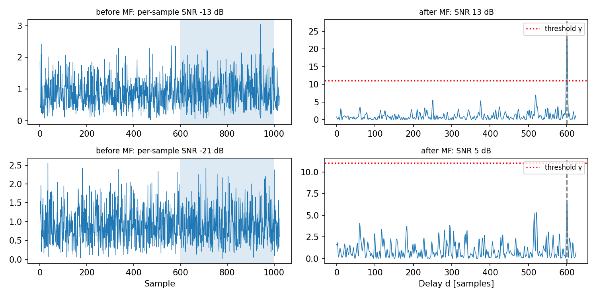
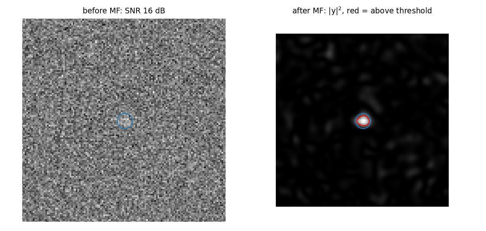

# detection

How far away can a small drone still be detected, and how much detection range is lost
for every piece of information the detector does not have?

<p>
  
  
</p>

The same matched-filter principle recovers a weak target in a radar echo (left)
and in an infrared image (right).

| Part | Content |
|---|---|
| [**Radar →**](rf/) | Linear chirp, matched filter, threshold detection with unknown delay |
| [**Infrared →**](image/) | Point target in images, 2D matched filter, detection with unknown position |

## Structure

```
rf/       radar signal model, matched filter, experiments
image/    infrared image model, 2D matched filter, experiments
figures/  generated plots
```

## Run

Run from the repository root:

```
pip install numpy scipy matplotlib
python -m rf.pd_curve
python -m image.pd_curve
```
