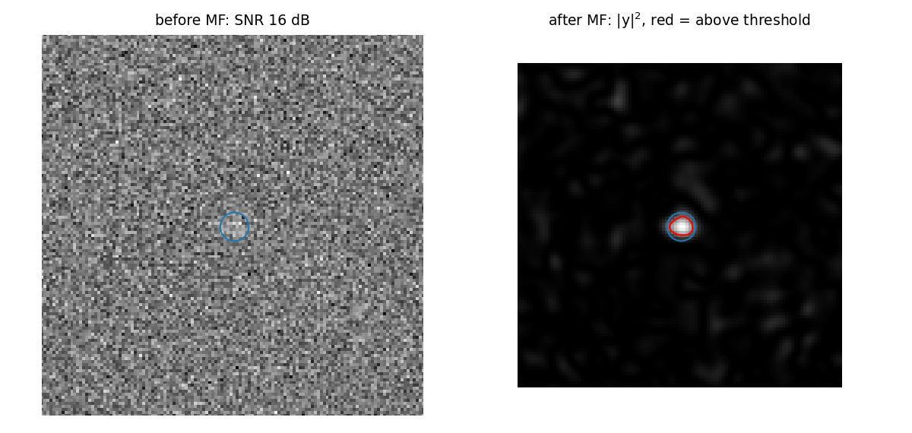
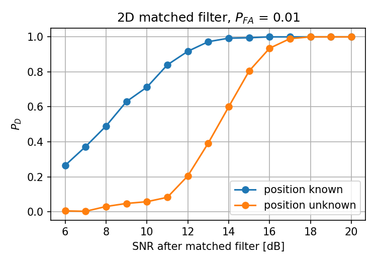

# Infrared

## Current model

$$z = a \cdot p(\theta) + w$$

Point target with Gaussian PSF $p$ at unknown position $\theta$, amplitude $a$, white Gaussian noise $w \sim \mathcal{N}(0, \sigma^2)$ per pixel. SNR $= a^2/\sigma^2$. Structured background, unknown target size, unknown noise level and target motion are added step by step.



The target is invisible in the raw image. After the 2D matched filter it stands out, red marks the pixels above the detection threshold.

## Detection



One decision per frame: maximum over all positions against a threshold set for
P_FA = 0.01 per frame, checked by Monte Carlo.

## Run

```
python -m ir.matched_filter   # before / after matched filter
python -m ir.hit_rate         # P_D vs. SNR
```
