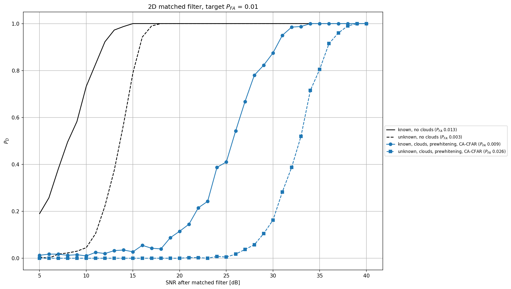

# Infrared

## Model

$$z = a \cdot p(\theta) + b + w$$

Point target with Gaussian PSF $p$ at unknown position $\theta$, amplitude $a$, structured background $b$, white Gaussian noise $w \sim \mathcal{N}(0, \sigma^2 I)$. Unknown noise level and target motion are added step by step.

The background models clouds as bright patches with soft edges and internal texture, blurred by the same PSF as the target:

```math
b = p \ast \left(c \cdot s \cdot \left(1 + \tfrac{1}{2}(u - \tau)\right)\right), \qquad s = \frac{1}{1 + e^{-(u - \tau)/\kappa}}
```

The cloud field $u$ is Gaussian noise $n$ with a power-law spectrum, normalized to zero mean and unit variance:

```math
u = \mathcal{F}^{-1}\left[\, |f|^{-\beta/2} \, \mathcal{F}[n] \,\right]
```

with spectral exponent $\beta$ (larger $\beta$: smoother clouds), contrast $c$, edge softness $\kappa$ and threshold $\tau$, chosen as a quantile of $u$ so that a given fraction of the image is covered by clouds. The field is generated at twice the image size and cropped, so the background is not periodic. Parameters: $\beta = 3.7$, $c = 50\,\sigma$, cloud cover $0.5$, $\kappa = 0.15$.


Simulated image at SNR = 30 dB, the red circle marks the target.
## Detection

### Detection without background


Detection without background ($b = 0$). With known position, the matched-filter output |y|² at the true position is compared against the Neyman–Pearson threshold. With unknown position, the GLRT is used.
### Detection with background



Detection with the cloud background $b$ from the model above, compared to the case without background (black). Two steps are added before the threshold:

**Prewhitening + matched filter.** The clouds are strongly correlated, so the matched filter is applied after whitening with the clutter spectrum:

```math
y = \mathcal{F}^{-1}\left[\frac{Z \cdot P^\ast}{\hat S}\right] = p^\top \hat C^{-1} z
```

The spectrum $\hat S$ of $b + w$ is estimated from the image itself (periodogram, smoothed over neighboring frequencies), so no prior knowledge of the clouds is used.

**CA-CFAR.** After whitening the remaining noise level still varies across the image (higher at cloud edges than in clear sky). Mean and standard deviation are therefore estimated locally on a square ring around each pixel (guard 3 px, outer half width 17 px), and $t = (y - \hat m)/\hat s$ is compared to the threshold. Because $\hat m$ and $\hat s$ are estimates, the threshold is taken from a Student-t distribution with the effective number of independent ring samples, computed from the correlation of $y$. For unknown position, the false-alarm probability per pixel is set to $P_{FA}/K$, with $K$ the number of positions, so that the probability of a false alarm anywhere in the image stays at most $P_{FA}$.

**Result.** The clouds cost about 18 dB at $P_D = 0.5$ (known position: 8 dB → 26 dB, unknown position: 14 dB → 33 dB). This is close to the theoretical loss of the optimal filter with the true clutter spectrum (about 19 dB for this cloud model), so estimating $\hat S$ from a single image costs only about 1 dB. The false-alarm rate is kept for known position (0.009), but exceeds the target for unknown position (0.026).

## Run

```
python -m image.image_sim        # simulated image with clouds
python -m image.matched_filter   # before / after matched filter
python -m image.hit_rate         # P_D vs. SNR, without and with clouds
```
