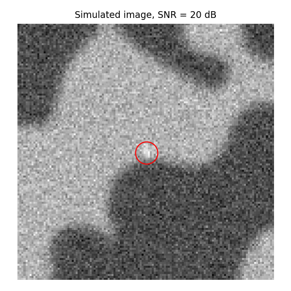

# Infrared

## Model

$$z = a \cdot p(\theta) + b + w$$

Point target with Gaussian PSF $p$ at unknown position $\theta$, amplitude $a$, structured background $b$, white Gaussian noise $w \sim \mathcal{N}(0, \sigma^2 I)$. Unknown noise level and target motion are added step by step.

The background models clouds as bright patches with sharp edges, blurred by the same PSF as the target:

```math
b = p \ast \left(c \cdot \mathbf{1}_{\lbrace u > \tau \rbrace}\right), \qquad u = g_s \ast n
```

with white Gaussian noise $n$, Gaussian kernel $g_s$ (width $s$ sets the cloud size), contrast $c$ and threshold $\tau$ chosen as a quantile of $u$, so that a fraction `fill` of the image is covered.



Simulated image at SNR = 20 dB, the red circle marks the target.

## Detection


With known position, the matched-filter output |y|² at the true position is compared against the Neyman–Pearson threshold. With unknown position, the GLRT is used.

## Run

```
python -m ir.matched_filter   # before / after matched filter
python -m ir.hit_rate         # P_D vs. SNR
```
