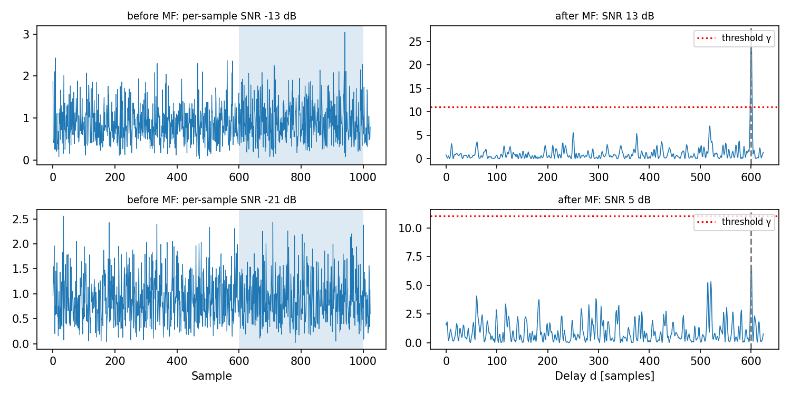
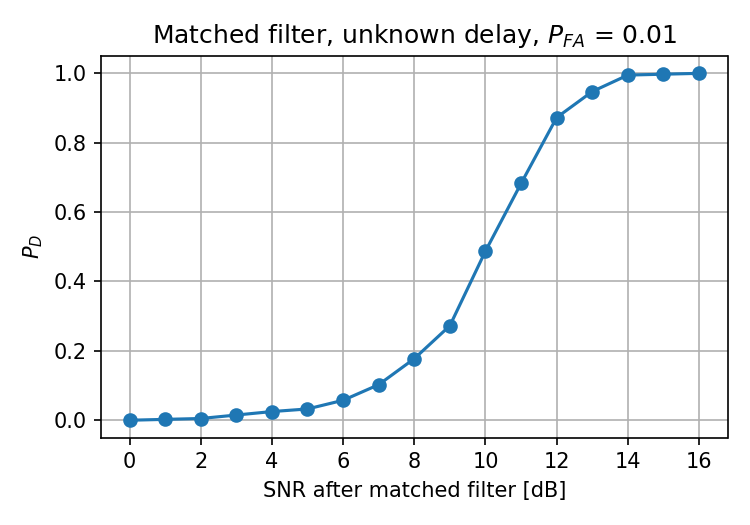

# RF Signal

Single-pulse radar: a linear chirp is sent, the echo arrives with unknown delay
and unknown phase in complex white Gaussian noise.

## Pulse compression



The echo is buried in noise per sample. The matched filter collects the energy
of all 400 samples into one peak (+26 dB).

## Detection with unknown delay



One decision per receive window: maximum of |y|² over all 625 delays against a
Neyman–Pearson threshold. P_FA = 0.01, checked by Monte Carlo.

## Run

```
python -m rf.matched_filter   # before / after matched filter
python -m rf.hit_rate         # P_D vs. SNR
```
